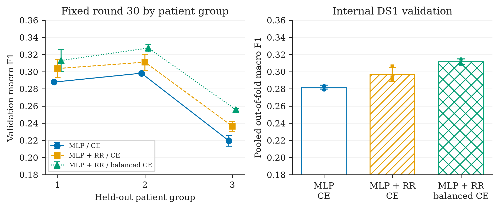
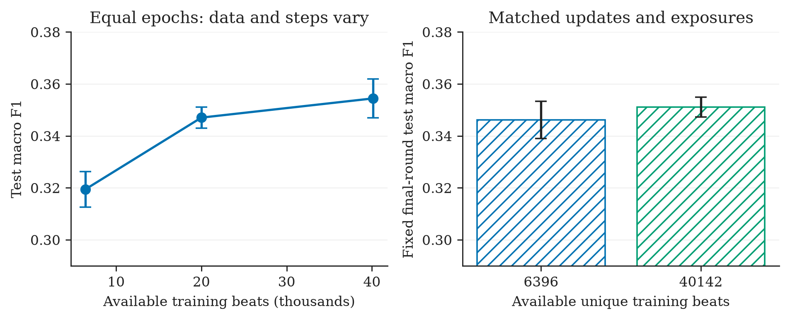
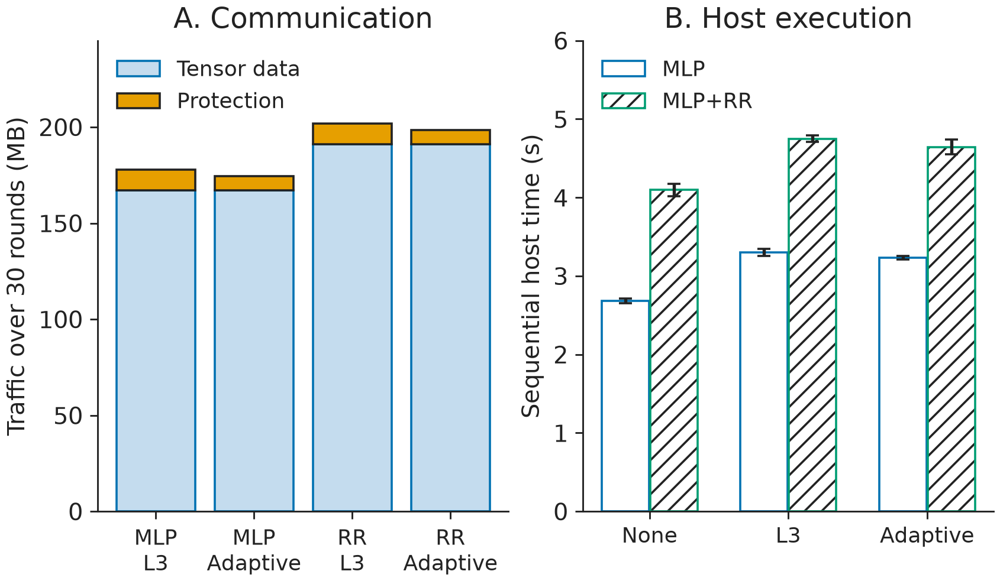

# Results and interpretation

The reference summaries retain all initial variants, full test denominators,
fixed-round and selected-checkpoint endpoints, per-class performance and patient
influence. A higher exploratory score is not treated as a validated winner.

## Classifier selection

MLP/CE reaches test macro-F1 0.3545 ± 0.0075 over five seeds, compared with
0.3377 ± 0.0123 for the initially validation-selected MLP+RR/balanced recipe.
Their paired difference is −0.0167780; its patient/seed interval is
[−0.0477117, +0.0319387]. The spatial CNN/focal result of 0.3781 ± 0.0068 uses
three seeds and was not selected by the validation criterion.

`complete_screen_common_seeds.csv` compares all 16 recipes on seeds 11,22,33.
This avoids confusing differences in seed count with architecture effects.
The five-seed endpoints add seeds 44 and 55 only for the baseline and initially
selected recipe.

The initial validation set has four F beats and no Q beats. Of its 395 S beats,
383 come from record 209. On the test set, record 232 supplies 75.2% of S beats
and record 213 supplies 93.3% of F beats. The selected recipe's mean S recall
is about 0.0444, F recall about 0.0010 and Q recall zero. Overall accuracy
therefore overstates utility for the intended five-class task.

## Patient-group validation

Pooled round-30 strict-DS1 out-of-fold macro-F1 is 0.2820 ± 0.0024 for MLP/CE,
0.2968 ± 0.0083 for MLP+RR/CE and 0.3116 ± 0.0032 for MLP+RR/balanced CE.
The balanced recipe ranks first in the three-recipe shortlist across all nine
fold/seed cells. F and Q recall remain zero for all three recipes. These
internal and external populations/training sets differ; their scores are
separate diagnostics of validation sensitivity.

## Training availability and exposure

With one local epoch per round, 6,396, 20,000 and 40,142 beats produce macro-F1
0.3194, 0.3471 and 0.3545 respectively, with validation-selected endpoints.
They also change optimizer-step counts, so the comparison combines data and
training-exposure effects.

At matched 9,630 steps and 1,232,640 replacement draws, small/full data produce
fixed-round macro-F1 0.3461 ± 0.0072 and 0.3511 ± 0.0038. The full-minus-small
difference is +0.0049323, interval [−0.0092435, +0.0238110]. Across three subset
draws crossed with three learning seeds, the mean is +0.0115688 with interval
[−0.0019250, +0.0316584]. Full-data models are reused across subset draws.

These controls weaken support for a gain attributable to unique example
availability alone. Replacement sampling, weighting and endpoint differ from
the one-epoch regime, so the two regimes are not a causal decomposition.

## Protected-model integration

All 54 executions preserve incoming payloads and every round's parameters under
paired schedules. All final states match their corresponding unprotected main
learners. The full-state comparison concerns six model/learning-seed pairs,
with complete arrays for one timing repeat and round hashes for every repeat.

Across 30 rounds and 17 clients, each run exchanges 1,020 messages. MLP raw
tensor traffic is 167.1372 MB; MLP+RR is 191.09496 MB. Fixed L3 adds 10.60392 MB;
the adaptive trace adds a seed mean of 7.304567 MB. This is a 31.11% reduction
in added bytes but only 1.86% / 1.64% in complete traffic for the two workloads.

The mean paired sequential-host-time reductions are 2.06% and 2.15%. These are
descriptive seed-wise averages on one host. Peak worker RSS includes the
interpreter, libraries, data loading, training and retained audit vectors.
Neither result establishes device-level latency, memory feasibility or physical
energy savings. Update preservation is also separate from predictive quality.

